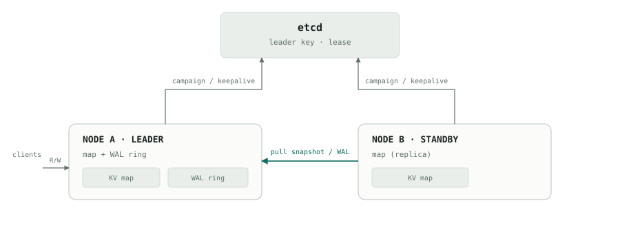
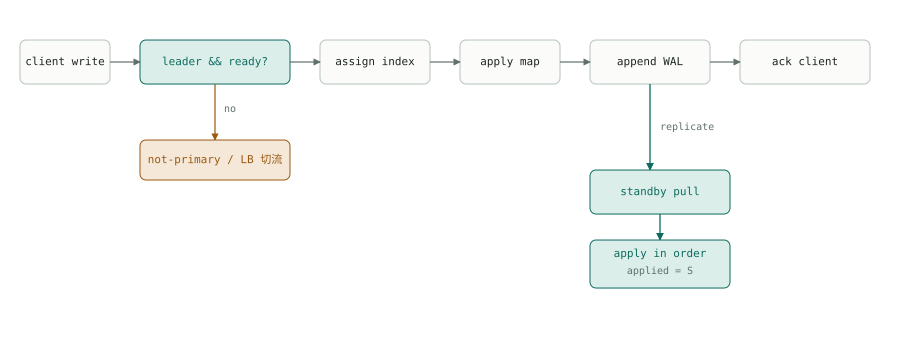
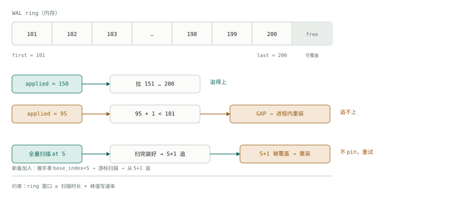
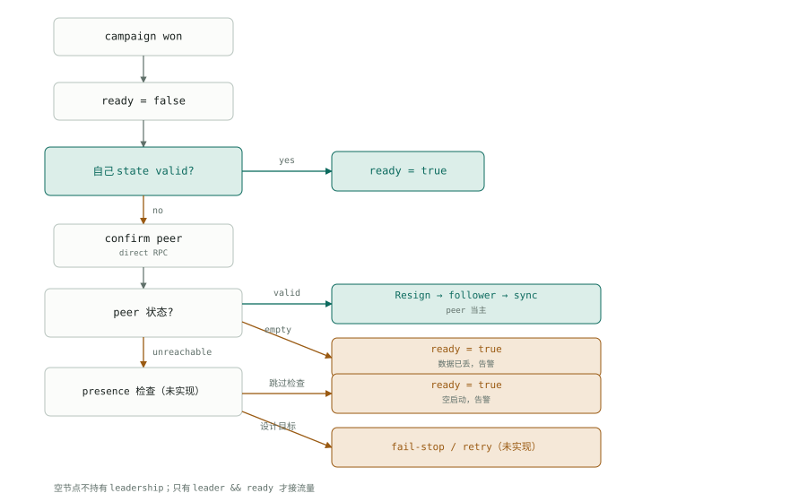

# Simple HA 复制设计

*Design note · 2026-10*

双节点元数据 KV：etcd 选主，内存 WAL 环形缓冲，备从主拉取。目标是最佳努力地少丢记录，而不是完备的一致性状态机。

**最佳努力** · **两节点均为候选** · **失去 lease 即停服** · **lease 4s（需显式配置，见 05）** · **备 1s pull** · **全内存**

## 01 架构

> etcd 只管选主（leader key + lease）；数据在两边内存里。备从主拉快照和 WAL。独立的 presence key 尚未实现，见遗留问题。



*同一套代码，角色由 election 决定；快照由当前 leader 提供。*

## 02 写路径

> 纯异步：主 apply + 追加 WAL 后立即 ack；备每 1s 拉一次，不参与写路径，也不对外提供读。落后 ≤1s 可接受。



*备的 pull 是 out-of-band 的；主不等待备，也不做 group commit。ack 后的写仍可能丢最后一段未复制的尾巴。*

备不对外提供读；读写都走主。当前实现不内联返回 redirect：非 leader 的节点由集成系统的 LB / 客户端重试切到新主（按 ready 路由），leader 但未 ready 时同样由客户端重试。设计目标是非主返回 redirect（target 带当前 leader + epoch）、leader 未 ready 返回 not-ready / retry-after；具体错误码与字段待集成系统确定。

## 03 追平

> 追得上就走 WAL；发现被覆盖不跳过去继续追，而是在进程内 stage-and-swap 重装：握手 + 全量快照 + 从 base+1 追。



*快照要带 base_index（`BeginSnapshot` 时随 WAL 前缀一起取得）；副本随后按 shard 读锁分批读取，扫描期间超过 base 的变化由 base+1 的 WAL 修正。装好之前不要对外服务。备发现 from < first 或 incarnation 变化，丢弃当前快照会话并在进程内 stage-and-swap 重装，不跳过去继续追。*

pull 响应带 first / last / incarnation；from < first、incarnation 变了、或 entries 索引不连续 → 作废当前快照会话，在进程内 stage-and-swap 全量重装，不跳过去继续追。重装期间没有备，主此时再挂就是全丢；失败按 backoff 重试。与早期设计不同：当前实现不退出进程，也没有 `WAL_OVERWRITTEN` 退出码。快照本身不需要 pin；不做 WAL pin，S+1 被覆盖就重装。ring 要覆盖整个扫描时长，否则会反复重装。

**全量扫描：** `BeginSnapshot` 返回 `snapshot_id` / `incarnation` / `base_batch_id` / `base_seq` 和 segment 列表；取到 base 后先等待 writer 的 durable-finalize 回调执行到 base（静默前缀）再开始扫描——否则延迟擦除（例如 discard expired processing replica）可能被扫进快照，而重放从 base+1 开始不会补删。扫描按 tenant（排序）→ shard（共 1024 片）逐个推进，每次 `SnapshotChunk` 带 `snapshot_id` / `tenant_index` / `shard_index` / `offset`，主侧在 shard 读锁内把该分片序列化成 entries 后按 offset 分页返回，响应带 `next_tenant_index` / `next_shard_index` / `next_offset` / `done`。只序列化 completed replica；扫描期间的新增、删除、修改都由 base+1 之后的 WAL 修正，批次之间不做快照隔离。分片在 shard 锁内一次取全，分页只发生在已固定的 staged 数据上，所以 offset 分页不会漏 key。扫描期间 base+1 被 ring 覆盖会作废会话（`INCOMPLETE_OPLOG_CATCH_UP`），备重装。会话只有一个消费者；游标不匹配（比如响应丢失后重试）会让会话作废并返回错误，备重新 `BeginSnapshot`。扫完、装好再回放 WAL；不要边扫边回放，否则旧 chunk 可能覆盖新 WAL 值。

## 04 升主

> 空节点赢了也不当主：探测到对端有数据就 Resign，让位后自己同步；对端不可达时当前实现按空启动并告警（未查询 presence，见 07）。



*空节点不持有 leadership；只有 leader && ready 才接流量。空节点让位后等对端升主，再从新主同步。分区恢复：老主失去 lease 立即 ready=false；**实现现状：**term 结束即释放本地状态，重连后从新主全量重装（设计目标是保留状态直到看到更高 epoch）；若此时对端不可达，重新当选会按空启动——见 07 已知限制。*

升主 restore 时，新主会给每个恢复对象统一 grant 一个 `default_kv_lease_ttl` 的读租约（组对象使用共享的组租约）。这覆盖客户端在旧主上持有的剩余租约窗口，避免新主的 eviction 与客户端仍在进行的直接读竞争。

扫描完成但 WAL 尚未追平时老主故障，备会以扫描得到的混合状态升主（可用性优先）。该路径会打印 WARN（`applied_seq` / `last_known_peer_durable_seq` / `lag` / `peer_unreachable`）并累加 `ha_simple_ha_degraded_promotions_total`；缺失的尾部在此架构下不可恢复。

## 05 故障切换预算

> 外部目标：进程 crash / 机器掉电 / 网络失联，备 ≤5s 感知，≤6s 开始服务（含客户端路由）。注意 etcd lease TTL 默认是 5s，要满足该预算需显式设置 `ha_leader_lease_ttl_sec=4`。

| 阶段 | 最坏 | 取值 |
| --- | --- | --- |
| crash → lease 过期 / 备感知 | 4.3s | T=4s，ε≤0.3s |
| 感知 → ready | 0.5s | P=0.5s |
| ready → 客户端路由 | 1.0s | R=1s |
| 合计 | 5.8s | 满足 5s 感知 / 6s 服务 |

```text
etcd lease TTL         ha_leader_lease_ttl_sec，默认 5s；本页预算按 4s 计算（需显式配置）
keepalive              etcd 内置 keepalive（设计目标 ~1s）
local serve deadline   设计目标 3s / 3.2s；当前无独立开关，停服由 leadership monitor 触发
presence               同一 session，TTL 4s（未实现）
peer_probe_timeout     设计目标 200ms × 2；当前 connect 1s + probe RPC 1s
promotion_budget       设计目标 0.5s（受 StopLoop join 影响，见遗留问题）
client retry / LB      ≤1s（客户端侧）
simple_ha_pull_interval 1000ms（--simple_ha_pull_interval_ms）
```

- **为什么 TTL=4s：** 最坏情况是 crash 紧跟一次 keepalive，lease 要等满 T 才过期。感知 = T + ε；T=5s 时 5+ε 已经破 5s。T=4s 留 0.7s 余量。如果只要求平均而非最坏，T=5s 也能用（平均感知 ≈4.3–4.5s）。
- **为什么 keepalive≈1s：** deadline 必须大于 2×keepalive，才能容忍一次延迟/丢失；又必须小于 TTL，才能抢在服务端过期前停服。T=4s、K=1s → D=3s，2K=2s，留 1s 余量。client 固定 T/3≈1.3s 时，2K=2.6s，D 取 3.2s。
- **为什么 deadline 是 3–3.2s：** 约束是 2K < D < T。D < T 保证活着的旧主在备可以升主之前停服，避免双主；D > 2K 保证一次 keepalive 抖动不误停。T−D≈0.8–1s 是分区场景的代价：旧主已停、备还不能升主，短空窗。把 D 推向 T 能缩小空窗，但安全余量也缩小；D ≥ T 就会重叠。
- **为什么 P=0.5s：** 备已经在 campaign 队列里，leader key 一消失就上位；它非空、不需要追数据，只做 state check + role switch。1s 的 pull 落后不影响这一步。
- **为什么 R=1s：** 备 ready ≠ 客户端能打过来。LB 检查间隔或客户端重试必须 ≤1s；如果 LB 5s 探一次，备 4.5s ready，客户端 9.5s 才恢复。
- **crash 与分区的空窗不同：** crash 时旧进程立即没了，空窗 = T − 相位 ≈3–4s；分区时旧主在 D 停服、备在 T 上位，空窗 = T−D ≈0.8–1s。新主的启动时间都是 T+ε+P，D 只影响分区空窗和防重叠。
- **1s pull 是另一条预算：** 它决定新主的状态最多旧 1s，不决定多久能服务。备升主时直接用当前 applied 的状态，不等旧主。
- **presence 的做法（未实现）：** 设计上计划与 election 共用 session，TTL=4s，不额外加 keepalive。key 在但 RPC 不通 → fail-stop/重试；key 没了且 RPC 不通 → 按进程已死处理（残余风险）。当前空节点只做一次 direct RPC 探测，不可达时 fail-open 直接空启动。

前提：etcd quorum 健康且 keepalive p99 ≪1s；备健康、非空、不在全量 resync；LB / 客户端重试 ≤1s。etcd 撑不住 4s 时，只能放宽目标或给这套服务独立 etcd。

## 06 状态与不变量

> 角色是意图，leader 是 lease，ready 是服务闸门。

| 信号 | 含义 |
| --- | --- |
| role | 意图（配置） |
| leader | leader key + lease 健康 |
| ready | 对外服务 |
| serve | `leader && ready` |

空节点允许 role=primary，但必须 leader=false、ready=false。空 = 未初始化（applied=0 / 无 lineage），不是 map 没有 key。lease 健康由 etcd keepalive + leadership monitor 判定；设计目标是本地 deadline 小于 etcd TTL（本页按 TTL=4s、deadline=3–3.2s 分析），超时立即 ready=false，不等网络恢复。当前实现没有独立的 `local_serve_deadline` 开关，停服由 monitor 触发。

| # | 不变量 |
| --- | --- |
| 01 | WAL 只记绝对 post-image（SET/DEL），可重复应用。 |
| 02 | 快照带 base_index，从 base+1 追；base 在 `BeginSnapshot` 时随 WAL 前缀取得，并等待 durable-finalize 回调执行到 base（静默前缀）后才开始扫描。 |
| 03 | 备发现 gap 不跳过去继续追：作废快照会话，在进程内 stage-and-swap 全量重装，再从 base+1 追；老主作废重装同样用 stage-and-swap。 |
| 04 | incarnation 变了 = 对端换了一个 WAL 实例（进程重启或重新升主都会换），不能盲信索引连续。 |
| 05 | ring 窗口要覆盖 1s pull 间隔、备短暂停机与全量扫描耗时；按峰值写速率/字节数定容，不能只按条数。 |
| 06 | 领导权跟数据走；空节点赢了，对端有数据就 Resign（对端不可达时当前实现按空启动，见 07）。 |
| 07 | snapshot / WAL 只由 leader 提供；只有 leader && ready 接流量。 |
| 08 | 空 = 未初始化（applied=0 / 无 lineage），不是 map 没有 key。 |
| 09 | 失去 lease 立即停服；term 结束即释放本地内存状态，重新以空备加入并从新主全量重装。设计目标是保留本地状态直到看到更高 epoch，当前实现未做跨任期保留（见 07）。 |
| 10 | 全量扫描按 tenant / shard 分批（每片在 shard 读锁内取全）；批次间不做快照隔离；先扫完再回放 base+1 的 WAL。 |
| 11 | 升主 restore 时为每个恢复对象 grant 一个 `default_kv_lease_ttl` 的读租约（组对象 grant 组租约），覆盖客户端在旧主上持有的剩余租约窗口。 |
| 12 | 全量同步期间允许以混合状态升主（可用性优先），但必须记录 degraded 指标并告警；不承诺跨 key 一致性。 |

## 07 故障与代价

> 真正的丢窗口是未复制的尾部（正常 ≤1s），以及脑裂期间老主 ack 的写；ring 覆盖只增加重同步成本。不做本地持久化，两边同时挂 = 全丢。已知限制：term 结束即释放内存状态，若对端此时不可达，重新当选会按空启动而丢全量；Simple HA 下 weight mutations 关闭，weight metadata 不复制、不进快照。

| 场景 | 行为 | 数据影响 |
| --- | --- | --- |
| 主进程崩溃 | 备升主 | 丢未复制的尾巴（正常 ≤1s） |
| 备落后被 ring 覆盖 | 备进程内重装 → 重新加入全量快照 | 不丢；备短暂不可用 |
| 备在全量同步刚完成、WAL 未追平时升主 | 以混合状态服务；记录 degraded 指标并告警 | 丢各 key 在扫描后未复制的写，窗口可达扫描时长；无跨 key 一致性 |
| 主重启且空 | 让位给备，自己同步 | 丢未复制的尾巴（正常 ≤1s） |
| 两边都重启且空 | tie-break 空启动 | 全丢（内存，不做本地持久化） |
| 全量扫描慢于 ring | 扩 ring / 重建会话退避重试 | 不丢，可能反复重装 |
| 主备短暂断连 | 重连后追 WAL | 不丢；延迟增加 |
| 老主脑裂后重连 | 失去 lease 停服并释放状态；重连后从新主全量重装 | 脑裂期间 ack 的写会丢 / 回退 |
| 在任主丢 lease 且对端不可达 | term 结束释放状态；重新当选按空启动 | 全丢（已知限制，待做跨任期保留） |
| Simple HA + weight 管理 | weight mutations 关闭 | weight metadata 不复制、不进快照 |

**丢窗口：** 纯异步，已 ack 的写可能丢最后一段未复制的尾巴；正常 ≤ 一个 pull 间隔（约 1s）。脑裂期间老主 ack 的写会在重连重装时被丢弃。ring 覆盖不会丢历史，只会触发重同步。

降级升主：全量同步刚完成、WAL 尚未追平时老主故障，备以扫描得到的混合状态服务。此时每个 key 都是某个合法 post-image，但不存在全局一致的 cursor；丢失范围是各 key 在扫描之后、崩溃之前未复制的写。该路径输出 WARN 并累加 `ha_simple_ha_degraded_promotions_total`，不承诺跨 key 一致性。

按本页参数：最坏感知 ≈4.3s，服务 ≈5.8s；crash 空窗 ≈3–4s，分区空窗 ≈0.8–1s。

## 遗留问题

主路径已按当前实现校准；下面这些是未实现或还没拍板的点。

1. **跨任期状态保留（高风险，未实现）** —— 当前 term 结束即释放在任 master 的内存状态，节点重新以空备加入。若唯一存活节点遇到 etcd lease 抖动、而对端又不可达，重新当选会按空启动并丢全量，超出“只丢 ≤1s 尾巴”的目标，也与不变量 06/09 的“领导权跟数据走”不一致。可行修法：term 结束时从已静默的 master 导出状态（writer Stop 会 drain durable callback，map 与 durable prefix 一致），填进 `PromotionContext` 交给已有的 `RestorePromotionBaseline`；需评估导出耗时与内存峰值。
2. **空节点 presence 检查（中风险，未实现）** —— 空节点只做一次 direct RPC 探测；对端不可达时 fail-open 直接空启动，没有按设计查询 presence key。探测响应只有一个 `has_data`，区分不了“对端空”和“对端正在全量同步”（同步完成前 `has_lineage=false`）。
3. **pull / ring 容量（低风险）** —— 评估 pull 速度跟不上写入增长的可能性不大；ring 仍需覆盖全量扫描耗时。备发现 gap 在进程内重装，失败按 backoff 重试，需配告警。
4. **全量扫描与重试** —— 不做 pin；按 tenant / shard 分批，批次间不做快照隔离；ring 要覆盖整个扫描时长；失败 / 覆盖后重建会话并退避重试；chunk 校验和与格式版本兼容尚未做（当前依赖 RPC 传输与 struct_pack 反序列化）。
5. **升主暂停时间（低风险）** —— 升主时 `StopLoop` 会 join 正在进行的 pull / snapshot chunk RPC（超时 5s / 10s），对端卡住时可能突破 P=0.5s 的预算；可考虑缩短超时或可中断的 RPC。
6. **客户端 / LB 切流（redirect）** —— 备不支持读，读写都走主。LB 按 ready 路由；设计目标是非主时请求返回 redirect，target 带当前 leader + epoch；leader 未 ready 返回 not-ready / retry-after。当前 master 不内联返回 redirect，依赖 LB / 客户端重试；具体错误码 / 字段待集成系统确定。
7. **全量 resync 期间的降级升主（已接受）** —— 扫描完成但 WAL 未追平老主就故障时，备以扫描得到的混合状态升主：每个 key 是某个合法 post-image，但不存在全局一致的 cursor。选择可用性优先——该架构下 fail-close 没有恢复路径，因为老主 term 结束也会释放状态，不会带着缺失尾部回来。已输出 WARN（applied / peer_durable / lag / peer_unreachable）并累加 `ha_simple_ha_degraded_promotions_total`；若上层依赖跨 key 同版本，需要自行做版本校验或改用 batch OpLog 路径。

*2026-10 · 已按当前实现校准，遗留项待续*
